# Helix

A constraint-aware DNA storage compiler and recovery testbench. Central question:
**How do sequence constraints and error-correction overhead affect reliable file recovery?**

## Run the portfolio demo

```sh
python3 -m venv .venv
.venv/bin/python -m pip install '.[test,plot]'
.venv/bin/python -m helix.demo
```

The single demo command encodes a binary payload with exact 50% GC, removes one
strand per group, applies one insertion/deletion to every remaining strand,
shuffles and duplicates reads, demonstrates baseline failure, and verifies exact
recovery with synchronization. Inspect `results/portfolio-demo/summary.json` and
the original/restored files. No original strands or damage log go to the decoder.

Start with the [expanded evaluation and charts](results/EVALUATION.md),
[format specification](docs/design.md), and [robustness review](docs/robustness.md).

## Channel model comes first

Helix models an unordered pool of DNA strings, with independent synthetic events:
substitution changes a base; insertion/deletion changes synchronization; dropout
removes a whole strand. Shuffling loses order; duplication repeats a damaged read.
It does not model chemistry, PCR bias, coverage consensus, quality scores, or sequencing platforms.

Version one corrects byte-symbol errors within the inner RS bound and missing strands
within the outer erasure bound. It rejects invalid lengths, alphabet, constrained
codewords, identifiers and checksums. Default decoding does not search for indel repairs:
net length changes are rejected, while balanced indels may pass length checks and
are handled only as arbitrary corruption. CRC and final SHA-256 detect residual
corruption probabilistically; there is no absolute detection guarantee.

[DNA Fountain (Erlich and Zielinski, 2017)](https://pubmed.ncbi.nlm.nih.gov/28254941/)
provides a research anchor for redundant storage and sequence screening.
[HEDGES (Press et al., 2020)](https://pmc.ncbi.nlm.nih.gov/articles/PMC7414044/)
shows why insertion/deletion recovery needs explicit synchronization coding.
Helix implements neither paper and does not reproduce their biological results.

## Smallest complete experiment

Python 3.11+:

```sh
python3 -m venv .venv
.venv/bin/pip install '.[test]'
printf 'DNA meets computer science.\n' > examples/message.txt
.venv/bin/python -m helix.cli encode examples/message.txt results/demo --config examples/storage.toml
.venv/bin/python -m helix.cli damage results/demo/strands.txt results/demo/reads.txt --seed 42 --dropout 0.1 --duplication 0.3
.venv/bin/python -m helix.cli decode results/demo/manifest.json results/demo/reads.txt results/demo/restored.txt
cmp examples/message.txt results/demo/restored.txt
.venv/bin/python -m pytest -q
.venv/bin/python -m helix.benchmark --trials 20
```

`decode` validates the complete file before writing output and exits nonzero on
failure. A failure experiment: use `--dropout 1`. The manifest is a required,
trusted out-of-band sidecar, not DNA-encoded or independently protected storage.
DNA output is one complete strand per line, with no primers. Use
`--config examples/gc.toml` for version-2 joint GC/homopolymer constraints.
See [GC results](results/GC-REPORT.md) for the comparison.

## Architecture

```mermaid
flowchart LR
    A[Bytes + TOML] --> B[Chunk and stripe]
    B --> C[Outer Reed–Solomon across strands]
    C --> D[File ID + index + payload + CRC]
    D --> E[Inner Reed–Solomon]
    E --> F[Naive or constrained mapping]
    F --> G[DNA pool + manifest]
    G --> H[Seeded channel]
    H --> I[Decode reads and inner RS]
    I --> J[Validate and deduplicate]
    J --> K[Outer erasure recovery]
    K --> L[Trim padding and verify SHA-256]
```



See [format and algorithms](docs/design.md) for exact metadata and correction bounds.
TOML is deliberately a small declarative configuration; unknown fields and
infeasible RS sizes are rejected before encoding. There is no programming language runtime.

## Evidence and portfolio demonstration

Tests include a published reedsolo vector, a naive mapping vector, exhaustive
single-byte inputs, exhaustive short DNA word counts, generated binary files,
independent sliding-window constraint validation, exact parity-budget erasures,
identifier correction, explicit failure cases, byte equality, and SHA verification.

The original benchmark compares naive, max-run-1 and max-run-3 encoders with two outer
redundancy budgets. It records seeds, payload hash, configuration, successes,
Wilson 95% intervals, total nucleotides, net payload bits/nt, manifest bytes,
overhead above ideal two-bit mapping, runtime and traced Python allocations.
Memory is not process RSS. Each recovery trial treats the entire file as success
or failure. Timing includes tracing overhead; simulator time is excluded. Small
trial counts provide demonstration evidence, not precise reliability estimates.

A portfolio walkthrough: show the same file under all three codecs, inspect
full-strand runs, damage the pools with identical channel parameters, restore the
file, verify it with `cmp`, then inspect the recovery/density tradeoff in the
benchmark JSON. Identical seeds are reproducible within the same implementation;
different strand lengths do not imply identical physical damage realizations.

## Focused milestones and acceptance criteria

1. **Complete baseline (implemented):** arbitrary bytes including empty files round-trip;
   shuffled/duplicated reads work; failures return nonzero. Why: establish a reference.
2. **Constraints and redundancy (implemented):** all assembled constrained strands
   meet max-run; recover any p erasures per stripe and t symbol errors per valid
   inner word when 2t <= inner parity. Why: separate density cost from protection.
3. **Reproducible evidence (implemented):** seeded scenario grid, raw results,
   uncertainty and accounting. Why: make the central question measurable.
4. **GC-constrained coding (implemented):** joint GC/run-state counting with
   per-byte GC bounds that guarantee the full-strand range, feasibility checks,
   inverse tests and benchmarks. Why: quantify a second constraint's incremental cost.
5. **Single-indel recovery (implemented):** opt-in exhaustive repair search with
   candidate budgets, ambiguity rejection, diagnostics and paired indel sweeps.
   Why: measure recovery gain against decoder CPU cost. Multiple-indel
   synchronization remains a future milestone.

Primers are a future optional biochemical addressing layer, distinct from software
file/chunk IDs. Their feasibility, interactions, and every assembly boundary would
need validation. This release makes no synthesis-readiness claim.

## Single-indel recovery demo

Use the existing encoded pool, damage it, and enable bounded synchronization:

```sh
.venv/bin/python -m helix.cli damage results/demo/strands.txt results/demo/indel-reads.txt --seed 42 --insertion 0.001 --deletion 0.001
.venv/bin/python -m helix.cli decode results/demo/manifest.json results/demo/indel-reads.txt results/demo/indel-restored.txt --single-indel --diagnostics results/demo/indel-diagnostics.json
.venv/bin/python -m helix.indel_benchmark
```

Success depends on the sampled pool; rates are not a promised correction bound.
See the [indel report](results/INDEL-REPORT.md) for paired recovery results and
[design](docs/design.md) for guarantees, budgets and unsupported cases.

## Automated checks and larger evaluation

```sh
.venv/bin/python -m pytest -q
.venv/bin/python -m helix.evaluate --trials 50
.venv/bin/python -m helix.indel_benchmark --trials 50 --output results/indel-expanded.json
.venv/bin/python -m helix.report
```

GitHub Actions runs tests and the deterministic demo on Python 3.11–3.14 after
push/PR. The workflow is supplied locally; no remote CI run or publication has
been performed. `requirements-lock.txt` records the local Python 3.14 environment;
use the package extras to resolve compatible dependencies on other Python versions.
