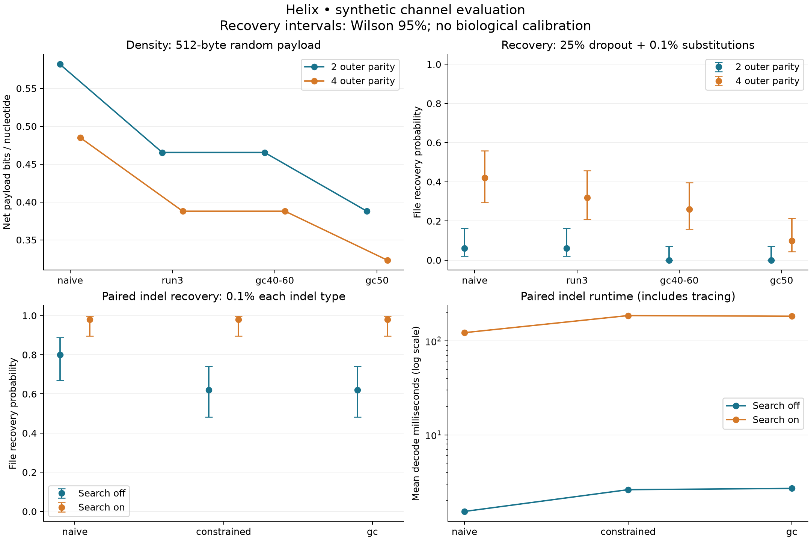

# Helix portfolio evaluation

144 broad scenarios and 7,200 file recovery trials, plus
9 paired indel scenarios with 50 seeds each.

Clean recovery: **2400/2400**. Payloads: 64 and 512 bytes;
patterns: all zeros, repeated text and seeded random bytes. Four codec profiles,
two outer-parity budgets, and clean/dropout/mixed channels are included.



## Paired single-indel results

| Codec | Search off | Search on | Mean ms off/on |
|---|---:|---:|---:|
| naive | 40/50 | 49/50 | 1.5 / 122.7 |
| constrained | 31/50 | 49/50 | 2.6 / 186.5 |
| gc | 31/50 | 49/50 | 2.7 / 183.6 |

Rates in this table are 0.1% insertion and 0.1% deletion per original base.
Search off/on use the same read pool within each seed. Different codecs have
different strings/lengths; their damage realizations are not physically matched.

## Interpretation and limits

Stricter GC coding and added parity consume density. Search improves recovery
for single-indel damage by spending CPU without adding bases. This simulator
assigns errors independently of sequence context, so it cannot measure the
biochemical benefits of constraints. Close recovery counts should be assessed
using intervals rather than ranked. Repeated tests of one encoded payload
estimate behavior conditional on that payload and channel, not all files.

These files are still small; this is a portfolio evaluation, not a production
scale or wet-lab validation. SHA-256, CRC and the external manifest remain part
of the assumptions. Density includes all DNA fields, padding and parity;
manifest bytes are reported separately in raw data. No synthesis copies or
sequencing coverage are modeled.

Broad encode times and trial-zero decode times include tracemalloc; later
broad decode trials do not. All paired indel times include tracing. Memory
fields are Python allocations, not RSS. Cache state and host load affect timing.

## Reproduce

```sh
python -m pip install '.[test,plot]'
python -m helix.evaluate --trials 50
python -m helix.indel_benchmark --trials 50 --output results/indel-expanded.json
python -m helix.report
```

Raw evidence: [broad trials](evaluation.json), [paired trials](indel-expanded.json).
Payload hashes, seed rules, configuration, versions, errors and timings are retained.
Original small reports remain historical snapshots; this report uses the expanded runs.
